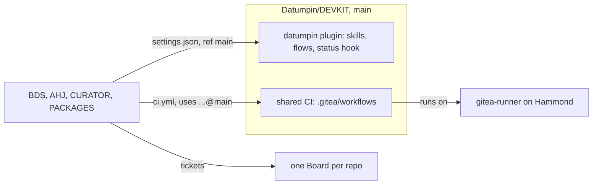
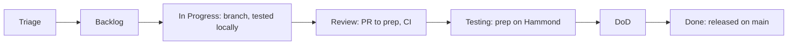

# Quickstart

**Scope:** The short tour of DEVKIT and the datumpin workflow: set a machine up, use the flows day to day, release a change, and where to look when stuck.
**Status:** current
**Last reviewed:** 2026-10-21

---

## What this is

DEVKIT holds Datumpin's fleet engineering tooling: the `datumpin` Claude Code plugin (the convention skills and the ticket workflow) and the shared CI workflows every repo calls. BDS, AHJ, CURATOR, PACKAGES and DEVKIT itself all use it the same way; the `conformance` CI job checks that they do.

## Quick-start

On a new machine, once:

1. Add the `gitea` SSH alias (`Host gitea`, `HostName 192.168.10.101`, `Port 2222`, `User git`) to `~/.ssh/config`.
2. Check it: `git ls-remote git@gitea:Datumpin/DEVKIT.git main` prints a commit.
3. Install `tea` and add two logins: your own (the default) and `squire`.
4. Install Docker Desktop. Builds and tests run in containers on the laptop; nothing else is installed on the host but `git`, `tea`, Python (for the status hook) and Claude Code.
5. In each repo you work in: `claude plugin install datumpin@datumpin --scope project` (the repo's committed `.claude/settings.json` names the marketplace).

A new session starts with a `datumpin status` line: Triage counts and open PRs. Start with `/datumpin:board`.

## Map of the pieces

- `plugins/datumpin/`: the plugin ([README](../plugins/datumpin/README.md)); `skills/` holds every skill and flow.
- `.gitea/workflows/`: what repos call from `ci.yml` (`python-tests`, `node-tests`, `compose-check`, `security-scan`, `conformance`), `board.yml` (`board-sync`) and `image.yml` (`docker-image`); PACKAGES' publish jobs call `publish-python` and `publish-npm`. DEVKIT's own `ci.yml` and `board.yml` call them from the checkout.
- `ci/master/`: the approved dependency versions every repo's pins must match (the `versions` job); a version changes here first, through a reviewed PR.
- `ci/`: the scripts the shared workflows fetch from `main`: `conformance.py`, `versions.py`, `board_sync.py`, `check-entrypoint.sh`, `push-image.sh`, `release-channel.sh`; their tests are in `ci/tests/`: run them locally first (`ci/tests/README.md`, Running locally); `ci.yml` re-runs them through `python-tests`.

## How to deploy

A DEVKIT release is a promotion: merge PRs into `prep`, then an Owner merges a `prep` → `main` PR. Repos follow `main`, so nothing reaches them before that. Then, in each repo: `claude plugin marketplace update datumpin` and `claude plugin update datumpin@datumpin --scope project`. A plugin change bumps `plugins/datumpin/.claude-plugin/plugin.json`.

## Common maintenance tasks

- **Pick up work:** `/datumpin:board`, then work a ticket on `<type>/<issue>-<slug>`.
- **Scope an idea into tickets:** `/datumpin:shape` (switch to Opus first).
- **Find drift between code, tickets and plans:** `/datumpin:align`.
- **End a session:** `/datumpin:handoff`, then `/datumpin:retro`; accepted findings become tickets.
- **Found a plugin or CI improvement elsewhere:** a DEVKIT ticket in Triage.
- **Bring a repo into the workflow:** the plugin README's onboarding list.
- **Upgrade the runner:** [runner.md](runner.md).
- **Change an approved version:** edit `ci/master/`, open a DEVKIT PR, then bring the repos to it.

## Where to go deeper

| Topic | Doc |
|---|---|
| Plugin contents, onboarding a repo, releasing | [plugins/datumpin/README.md](../plugins/datumpin/README.md) |
| Every skill | [plugins/datumpin/skills/README.md](../plugins/datumpin/skills/README.md) |
| Output shapes (tickets, PRs, log lines) | `formats` skill |
| Shared CI and branch protection | `gitea-workflows` skill |
| The Actions runner | [runner.md](runner.md) |
| Direction and milestones | [plan/ROADMAP.md](plan/ROADMAP.md) |
| The workflow's design | WIKI `business_processes/proposals/agentic_workflow.md` |

## When stuck

- **`/datumpin:...` is missing:** run the two update commands in How to deploy, then start a new session.
- **No status line:** `python` and `tea` must be on the PATH, and Gitea reachable.
- **A CI call to `@main` fails with "object does not exist", or a script "No such file":** the workflow or script is not released to DEVKIT `main` yet.
- **`versions` fails:** a listed package is pinned off its master version; the log names it.
- **An image push answers 401:** the account behind `PKG_WRITE_TOKEN` lacks packages write on the org.
- **`conformance` fails:** its log names the rule; the skill it cites says how to fix it.
- Then: [CLAUDE.md](../CLAUDE.md), the skills, and the DEVKIT Board.
